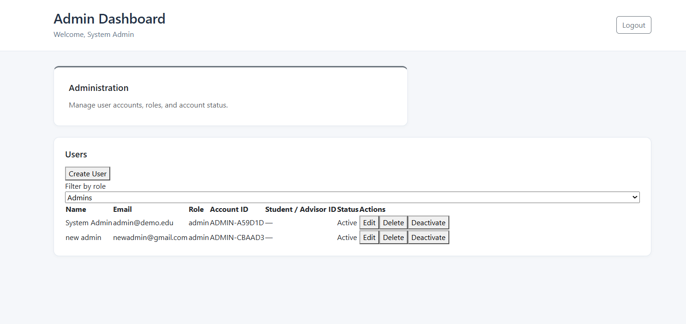
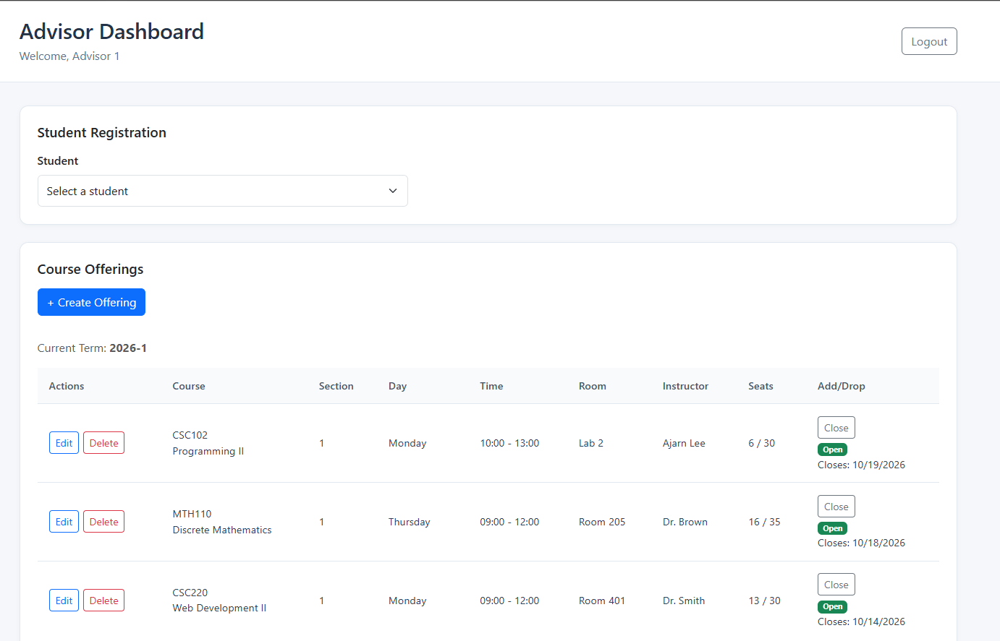
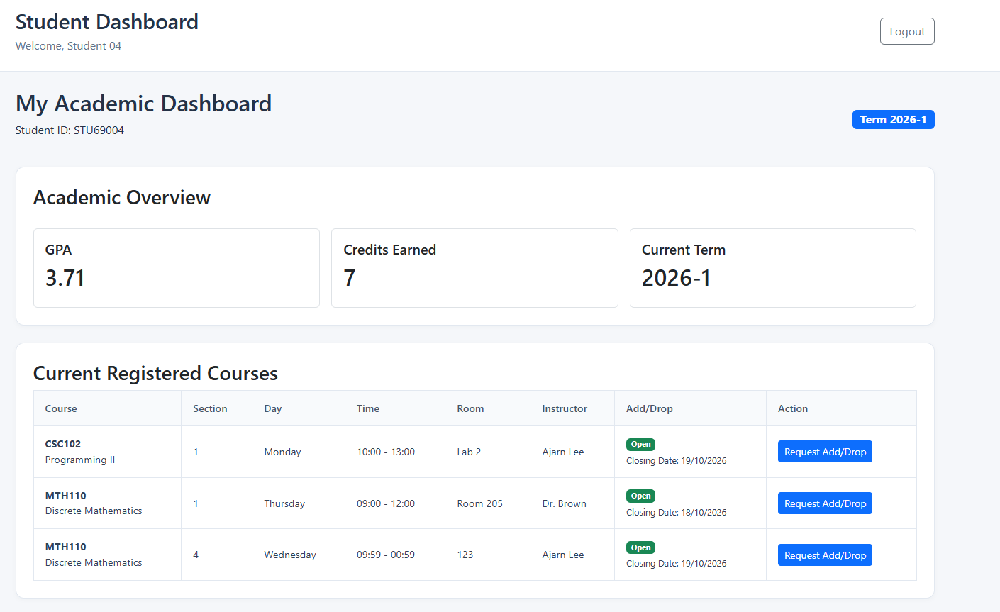

# Course Registration System

## 1. Project Information

- **Course:** CSC220 – Web Development II
- **Project Title:** Final Project – Course Registration System

### Group Members

| No. | Name | Student ID | Role |
|---|---|---|---|
| 1 | Thetti Oo | 2503110008 | Database & Data Lead |
| 2 | Atisha Paharat | 2406250005 | Front-end Developer A |
| 3 | Aye Mon Yadanar Aung | 2410290011 | Back-end Developer (API) |
| 4 | Min Khant Kyaw | 2403180030 | Team Lead |
| 5 | Ye Htet Aung | 2403180009 | Front-end Developer B |

## 2. Project Description

The Course Registration System is a full-stack web application designed to support university course registration and academic record management. It provides separate dashboards for administrators, academic advisors, and students.

The frontend is built with React and Vite, the backend uses Node.js and Express.js, and MongoDB stores application data. The system uses bcrypt for password hashing and JSON Web Tokens (JWT) for authentication.

## 3. Implemented Features

### Authentication
- Shared login page for administrators, advisors, and students.
- Password hashing using bcrypt.
- JWT-based authentication.
- Role-based dashboard access.
- Protected API endpoints.
- Logout functionality.

### Administrator Dashboard
- View and filter user accounts.
- Create new user accounts.
- Edit user information.
- Delete accounts without academic history.
- Deactivate accounts with academic history.
- Activate and deactivate accounts, where implemented.

### Advisor Dashboard
- Create, edit, and delete course offerings.
- Manage course terms, sections, schedules, rooms, instructors, and seat limits.
- Open and close registration.
- View student academic records.
- Check course eligibility.
- Register students and drop registrations.
- Validate schedule clashes and course eligibility.

### Student Dashboard
- View course offerings and registration information.
- View completed courses and academic records.
- View grades and credits, where implemented.
- View registration and add/drop information.

## 4. Technologies Used

- **Frontend:** React, Vite, JavaScript, CSS
- **Backend:** Node.js, Express.js
- **Database:** MongoDB, Mongoose
- **Authentication:** bcrypt, JSON Web Tokens (JWT)
- **Version Control:** Git and GitHub

## 5. Repository

GitHub repository: [Final Project – Course Registration System CSC220](https://github.com/Itsuki-Makuto/Final-Project-Course-Registration-System-CSC220)

## 6. Installation and Setup

### Prerequisites
- Node.js and npm
- Git
- MongoDB Atlas account or a configured MongoDB instance

### Step 1: Clone the repository

```bash
git clone https://github.com/Itsuki-Makuto/Final-Project-Course-Registration-System-CSC220.git
cd Final-Project-Course-Registration-System-CSC220
```

### Step 2: Install backend dependencies

Run this command in the project root:

```bash
npm install
```

### Step 3: Configure environment variables

Create a `.env` file in the project root and configure the variables required by the backend.

Example:

```env
MONGO_URI=your_mongodb_connection_string
JWT_SECRET=your_long_random_secret
PORT=3000
```

Replace the example values with your actual configuration.

### Step 4: Seed the database

Run the seed script from the project root:

```bash
node seed.js
```

This should populate the database with the initial data and test accounts configured in the seed script.

### Step 5: Install frontend dependencies

Open a second terminal and run:

```bash
cd client
npm install
```

### Step 6: Start the backend server

In the first terminal, from the project root:

```bash
node app.js
```

The backend should run at:

`http://localhost:3000`

Confirm that the server starts and connects successfully to MongoDB.

### Step 7: Start the frontend server

In the second terminal, inside the `client` directory:

```bash
npm run dev
```

Open the URL displayed by Vite, usually:

`http://localhost:5173`

Keep both servers running while using the application.

## 7. Test Login Accounts

Use the following accounts to test the three user roles.

| Role | Email | Password |
|---|---|---|
| Administrator | admin@demo.edu | password123 |
| Advisor | advisor1@demo.edu | password123 |
| Student | stu69004@demo.edu | password123 |

These are the intended test login details.

## 8. Dashboard Screenshots

The dashboard screenshots are stored in `client/public/` in the repository.

### Administrator Dashboard



### Advisor Dashboard



### Student Dashboard



## 9. Known Limitations

- **Limited scalability:** The dashboards are currently designed and tested with a relatively small dataset. When the database contains a large number of records, the interface may become crowded, making information harder to view and navigate.
- **Basic UI styling:** The application currently uses basic CSS styling. Further improvements to the layout, responsiveness, and visual consistency would improve the user experience.
- **Future improvements:** Potential improvements include pagination, better data organization, responsive layouts, and more advanced styling to support larger datasets and improve usability.

## 10. Implementation Status

| Feature | Status | Notes |
|---|---|---|
| Authentication and login | Complete| Users can log in using their email and password. The system supports administrator, advisor, and student roles. |
| Password hashing and JWT | Complete| Passwords are stored as bcrypt hashes, and JWT is used for authentication. |
| Role-based access control | Complete| Protected API endpoints use authentication middleware and role checks to restrict access. |
| Administrator user management | Complete| Administrators can view, filter, create, and edit user accounts, as well as delete or deactivate accounts according to their academic history. |
| Advisor offering management | Complete| Advisors can create, edit, and delete course offerings and manage offering details, registration availability, and add/drop deadlines. |
| Student academic records | Complete| Advisors can view student academic records, including completed courses, terms, grades, and credits. |
| Course eligibility checks | Complete | The system checks academic records to prevent students from registering for courses they have already passed. |
| Registration and dropping | Complete | Advisors can register students for eligible offerings and drop existing registrations. |
| Schedule clash validation | Complete | The system checks for overlapping course schedules and prevents conflicting registrations. |
| Student dashboard | Complete| Verify student-facing functionality |
| GPA and credit calculations | Complete | Verify calculations, if implemented |
| Add/drop request workflow | Partial | Can download add/drop from but haven't implemented email server |

### Final Notes

This project demonstrates the development of a full-stack course registration application with role-specific interfaces, database integration, and authentication.

